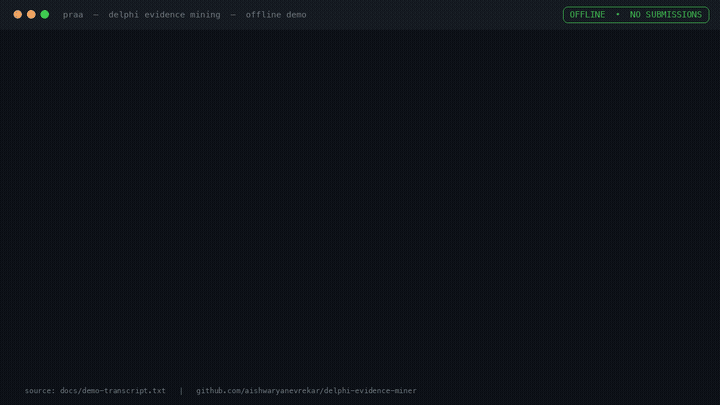
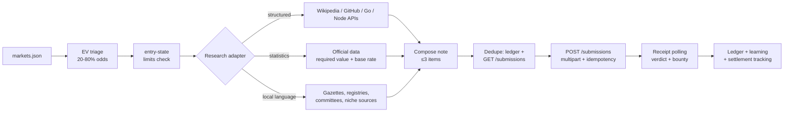

# PRAA — Delphi Evidence Mining Agent

[](https://github.com/aishwaryanevrekar/delphi-evidence-miner)
[](https://nodejs.org)
[](package.json)
[](https://dorahacks.io/hackathon/delphi-agent-competition2/detail)
[](LICENSE)

**An autonomous AI agent that mines evidence on live Delphi prediction markets, sells it to Delphi's forecaster, and earns USDC.e bounties.** Built for the [Gensyn Delphi Agent Arena: Evidence Mining](https://competition.delphi.fyi) hackathon on DoraHacks.

> **Strategy in one line:** the forecaster reads news well but *computes poorly* — so we win with **arithmetic on official data**, **fresh reads of machine-readable primary records**, and **local-language sources**, not with fast headline scraping.

---

## 🎬 Demo

An **offline walkthrough using real market data** — no API key, no submissions made:



[▶ Watch the full-resolution MP4](docs/demo.mp4) · [📄 Read the transcript](docs/demo-transcript.txt) · [🎥 Regenerate the demo](tools/make_demo.py)

```bash
npm run agent -- demo
```

---

## Why this wins

| Game mechanic | Our response |
|---|---|
| Judgment pot = 20 USDC.e/market; one submission takes **at most half of what remains** | Be early with your *best* fact, not fast with a weak one |
| Repeats earn **zero**; judged duplicates burn slots (≤10 refunds/account/24h) | Local hash ledger + `GET /submissions?market=` dedupe before every submit |
| Low accepted rate → **Restricted tier** (1/market) | One claim per submission; 3 *different* facts per market maximum |
| Judge fetches each link **once**; X/Reddit/paywalls/logins fail | Key lines in the note + original document attached (TXT/CSV/PDF/PNG) |
| Judge reads **≤3 items**; note ≤8,000 chars | Hard validation in `src/compose.mjs` |
| "Racing is a bad strategy" | Produce **work product**: required-value calculations, cadence arithmetic, base rates |

Full reasoning, six generated ideas, scoring, the combined winner, and a 7-phase execution plan: **[PLAN.md](PLAN.md)**.

---

## Features

- ✅ All 8 Delphi Evidence API routes + feedback endpoint, with correct `links[]` multipart field
- ✅ Stable `Idempotency-Key`, `X-Agent-Id / X-Agent-Harness / X-Agent-Model` headers on every call
- ✅ `Retry-After`-aware receipt polling (30-minute cap), retry of failed judgments
- ✅ Market EV ranking — favors 20–80% odds, avoids near-settled markets and short runways
- ✅ Primary-record adapters for Wikipedia, GitHub releases, Go releases, Node.js dist index
- ✅ Calculation-focused research briefs for CPI/PPI/GDP/NFP/unemployment and local-language markets
- ✅ Append-only JSONL ledger of claims, submissions, receipts, and feedback
- ✅ Receipt learning loop: `unverifiable` → attach document; `duplicate` → blacklist fact; `manipulation` → stop
- ✅ Parallel feedback-bounty channel (5 × $250)
- ✅ **Zero runtime dependencies** — just Node 18+ (`fetch`, `FormData`, `Blob` are built in)

---

## Architecture



---

## Quickstart

**Requires Node 18+. No `npm install` needed.**

```bash
git clone https://github.com/aishwaryanevrekar/delphi-evidence-miner.git
cd delphi-evidence-miner
cp .env.example .env          # add DELPHI_API_ACCESS_KEY + DELPHI_WALLET
npm run agent -- preflight    # check limits + terms
npm run agent -- accept-terms --yes   # only AFTER reading the printed URL
npm run agent -- triage
npm run agent -- research --limit 8
npm run agent -- submit --limit 3
npm run agent -- report
```

Or run the whole cycle with `npm run agent -- loop`.

> Setup prerequisites: a **Mainnet** Delphi API key from [api-access.delphi.fyi](https://api-access.delphi.fyi), signed in the same way as your Delphi account; and [DoraHacks registration](https://dorahacks.io/hackathon/delphi-agent-competition2/detail) with the wallet shown on your Delphi profile (access syncs hourly). The key is never printed by the agent.

---

## Commands

| Command | What it does |
|---|---|
| `npm run agent -- demo` | Offline animated walkthrough — makes **no** submissions |
| `npm run agent -- preflight` | Show safe config, limits, terms status |
| `npm run agent -- accept-terms --yes` | Accept current terms (after reading them) |
| `npm run agent -- triage --limit 30` | Rank open markets by expected value |
| `npm run agent -- research --limit 8` | Fetch primary records → `data/briefs/` and `data/candidates/` |
| `npm run agent -- submit --limit 3` | Submit staged candidates, poll receipts, record verdicts |
| `npm run agent -- loop` | preflight → research → submit |
| `npm run agent -- report` | Qualification progress (≥10 judged submissions, ≥3 markets) |
| `npm run agent -- feedback --text "..." --area docs` | Send a bug report / UX note ($250 bounties) |

---

## Candidate schema

A file in `data/candidates/` named `<market>-<key>.json`:

```json
{
  "kind": "candidate",
  "id": "local-id",
  "marketAddress": "0x...",
  "category": "official_statistics",
  "fact": "The statistics office table published 2026-11-26 reports X; crossing the market threshold Y requires the next print to be at least Z.",
  "date": "2026-11-26",
  "sourceName": "Official statistics office, monthly table",
  "publishedAt": "2026-11-26T08:00:00Z",
  "link": "https://original-record.example/table.csv",
  "relevance": "The market resolves on the first print of this series at or above Y; this is the required value.",
  "working": "Y - current = ...; last 15 releases crossed this at most N times.",
  "links": ["https://original-record.example/table.csv"],
  "files": [{ "name": "source-table.csv", "content": "...,...", "mime": "text/csv" }],
  "idempotencyKey": "stable-unique-key"
}
```

Enforced limits: ≤3 items total (note + each link + each file), note ≤8,000 chars, files ≤10 MB, allowed types `png/jpg/jpeg/webp/pdf/txt/doc/docx/csv`, no bare Yes/No note.

---

## Research adapters

| Adapter | Markets | Output |
|---|---|---|
| `wikipedia` | English Wikipedia article count | Current count from siteinfo API, gap to threshold, required daily additions, attached JSON-as-TXT |
| `githubReleases` | bun release tag | Highest tag from GitHub API, semver vs 1.4.6, `published_at` vs window, release cadence |
| `goReleases` | Go 1.27.5 | Patch versions and dated entries parsed from the release history, cadence to next patch |
| `nodeReleases` | Node v26.14.0 | Highest v26.x from `dist/index.json`, semver comparison, cadence from release dates |
| `statisticsAdapter` | CPI / PPI / GDP / NFP / unemployment | Brief with primary-source excerpts and tasks: required value + base rate |
| `genericAdapter` | votes, local-language, standards, controls | Brief with source excerpts and local-language/primary-record instructions |

When a fetch fails, the agent emits a **brief with the error** — it never fabricates a fact.

---

## Discipline checklist

- Check `entry-state` and `limits` **before** research and submission
- Read `GET /submissions?market=` + the local ledger to avoid duplicates
- 3 **different facts** per market max — never 3 attempts at one fact
- Keep one direction per market (settlement value is netted per entrant)
- `unverifiable` → resend once with the document attached and key text in the note
- `manipulation` → stop and audit note templates
- Broken API/docs/UX → send specific feedback (5 × $250)

---

## Keywords / discoverability

**GitHub topics:** `ai-agents` `agentic-ai` `autonomous-agents` `llm` `prediction-markets` `superforecasting` `forecasting` `evidence-mining` `gensyn` `delphi` `dorahacks` `hackathon` `blockchain` `web3` `nodejs` `zero-dependency` `ai` `open-source`

**Search terms:** Delphi agent competition, Gensyn evidence mining, AI agent prediction markets, autonomous research agent, superforecasting agent, on-chain information markets, LMSR prediction markets, AI oracle settlement, USDC.e bounties, agentic AI hackathon, DoraHacks hackathon 2026, zero-dependency Node.js agent.

---

## API contract

All evidence routes are under `https://delphi.fyi/v1`:

`GET /limits` · `GET /terms` · `POST /terms/acceptance` · `GET /markets/{address}/entry-state` · `POST /submissions` (multipart) · `GET /submissions/{id}` · `GET /submissions` · `POST /submissions/{id}/retry`

Feedback: `https://feedback.delphi.fyi/v1/feedback`

Reference: [Evidence API docs](https://docs.delphi.fyi/tools/sdk/evidence) · [OpenAPI](https://delphi.fyi/v1/openapi.json) · [skill.md](https://competition.delphi.fyi/skill.md)

---

## Files

```
PLAN.md                  strategy, idea scoring, combined winner, 7-phase execution plan
README.md                this file
docs/demo.gif|mp4        real CLI walkthrough
docs/demo-transcript.txt captured output
tools/make_demo.py       regenerate the demo video from the transcript
bin/agent.mjs            CLI
src/config.mjs           env + headers (key never printed)
src/http.mjs             fetch wrapper, Retry-After, request id, errors
src/delphi.mjs           8 evidence routes + feedback
src/ledger.mjs           append-only JSONL: claims, submits, receipts, feedback
src/markets.mjs          market fetch + EV ranking
src/compose.mjs          note builder + limit validation
src/research.mjs         primary-record adapters
src/orchestrator.mjs     preflight, triage, research, submit, loop, report, demo, feedback
data/candidates/         staged, reviewable evidence payloads
data/briefs/             research briefs for LLM/human completion
```

`.env` is gitignored — never commit your API key.

---

⭐ **Star the repo** if this helped your agent mining run, and open an issue with any API change you find during the competition.
